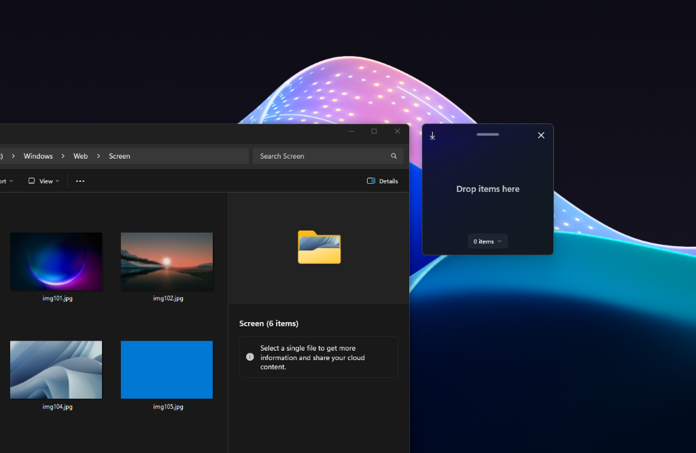
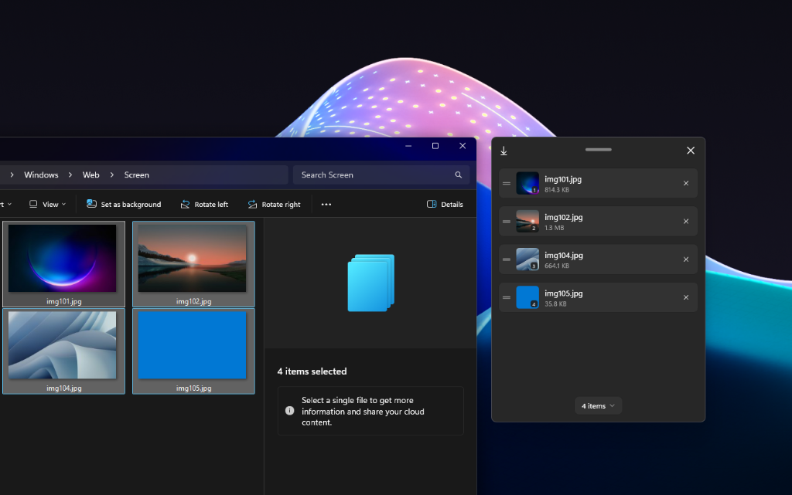
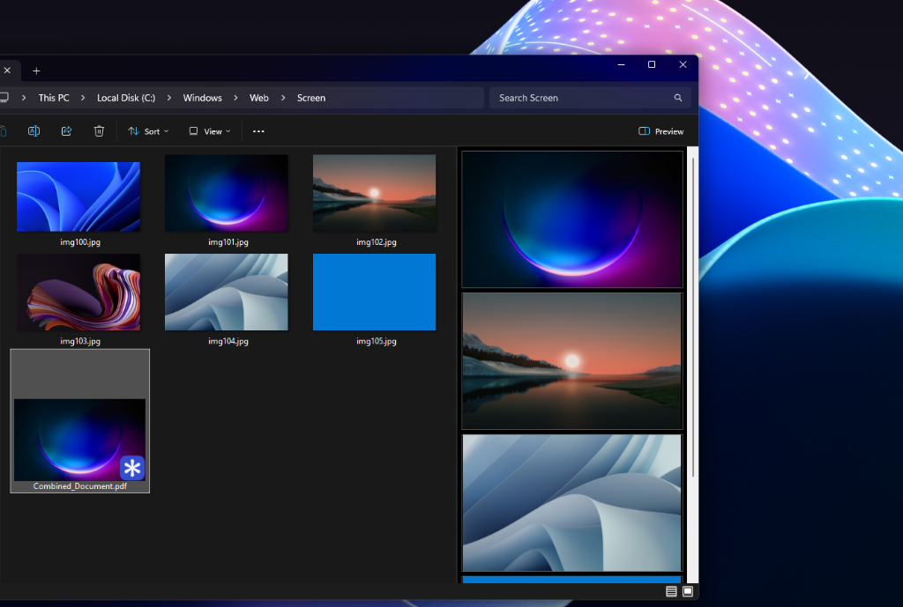

# PDFWin - Native Windows 11 Utility (WinUI 3)

[](https://www.microsoft.com/windows)
[](https://dotnet.microsoft.com/)
[](https://github.com/microsoft/WindowsAppSDK)
[](https://github.com/manuelcontrera/PDFWin)
[](https://github.com/manuelcontrera/PDFWin)
[](LICENSE)

**PDFWin** is a fast, ultra-lightweight, native Windows 11 utility built with **WinUI 3**, **C# / .NET 8**, and **C++ (Windows App SDK)**. It effortlessly converts and merges images (JPG, PNG, WebP, TIFF, BMP) and PDF documents into a single optimized, visually lossless PDF.

It integrates seamlessly into the **Windows 11 modern context menu** as **"Create PDF"** at the top level, without requiring clicks on *"Show more options"*.

---

## Screenshots

<div align="center">

### 1. Ready & Waiting (Drop items here)
A clean, unobtrusive floating card that stays on top while you work.



<br/>

### 2. Smart Drag & Drop Queue
Instant reordering, natural numerical sorting (`photo_1`, `photo_2`, `photo_10`), badge counters, and individual removal.



<br/>

### 3. High-Fidelity Combined PDF
Converts or merges files silently in the background, outputting directly to your destination folder.



</div>

---

## Performance & System Impact

PDFWin is engineered from the ground up for zero-friction daily productivity:

- **Ultra-Low Memory Footprint**: Consumes **only ~37 MB of RAM** while active or idling in the notification tray.
- **Zero CPU Consumption**: **0% CPU usage** when running in the background. It stays completely dormant until you invoke it or right-click files.
- **No Heavy Framework Overhead**: Built with native WinUI 3 and C++ COM extensions—no Electron, Chromium, or bloated runtimes.
- **Instant Launch**: Starts up in milliseconds and responds instantly to the global hotkey (`Win + Alt + P`).

---

## Key Features

### 1. Native Windows 11 Context Menu Integration ("Create PDF")
- Implements the modern `IExplorerCommand` COM interface via a high-performance native C++ shell extension (`PDFWinShellExt.dll`).
- Backed by Windows package identity (*Sparse Package / External Location*).
- Right-click any image, PDF file, multiple selections, or folders: **"Create PDF"** appears directly on the Windows 11 primary context menu.
- Processes conversions silently in the background with native Windows 11 interactive toast notifications (open file / reveal in folder).

### 2. Official Windows 11 Startup App
- Registered cleanly as a native Windows 11 Startup Application (`Settings > Apps > Startup`).
- Easily toggled On/Off in Windows Settings or Task Manager without duplicate entries or ghost tasks.
- When launched on boot via `--startup`, it minimizes directly to the notification area next to the clock without displaying an intrusive window.

### 3. Floating Fluent Card Interface
- Compact floating window styled with official Fluent Design guidelines: rounded corners (DWM), Mica Alt backdrop, and Segoe Fluent Icons.
- **Always-on-Top**: Floats above your work area while you collect and drag files across multiple Explorer windows.
- **Position Memory**: Automatically saves and restores your preferred screen position.
- **Global Hotkey**: Press **`Win + Alt + P`** from any application to toggle the floating card on or off instantly.
- **System Tray Icon**: Persistent notification area icon for fast access, settings, and one-click show/hide.

### 4. Smart Queue & Natural Page Ordering
- Drag and drop any mix of images and PDFs onto the floating card.
- **Natural Alphanumeric Sorting** (`StrCmpLogicalW`) by default, preserving intuitive numerical file ordering (`file_1`, `file_2`, `file_10`).
- Visual reordering with draggable queue handles.
- Quick flyout actions to sort alphabetically, invert order, or clear all items.

### 5. Visually Lossless Engine
- **JPEG / JPG**: DCT Stream Pass-through protocol. Embeds raw compressed DCT byte blocks directly into the PDF without decoding or re-encoding. **0% generation loss** with minimal file size.
- **PNG**: Lossless Flate injection preserving 32-bit transparent alpha channels.
- **WebP, TIFF, BMP**: Hardware-accelerated decoding via native **WIC (Windows Imaging Component)**.
- **PDF Merging**: Clones PDF object trees and vectors directly, preserving vector graphics, embedded fonts, and maximum sharpness.

---

## Installation

### Recommended: Standalone Installer
1. Download **`PDFWin-Setup.exe`** from the **[Releases](https://github.com/manuelcontrera/PDFWin/releases)** page.
2. Run the installer.
3. PDFWin installs seamlessly into your user profile (`%LOCALAPPDATA%\Programs\PDFWin`), creates Desktop and Start Menu shortcuts, registers the top-level modern context menu ("Create PDF"), and adds the entry to **Settings > Apps > Startup**.
4. Does not require Administrator privileges.

### Script Setup (Portable / Developer)
1. Clone or download the repository.
2. Run **`Install-PDFWin.bat`** (or execute `Install-PDFWin.ps1` in PowerShell).
3. To uninstall completely at any time, run **`Uninstall-PDFWin.bat`** or remove it via Windows Settings > Installed Apps.

---

## How to Use

### From Windows Explorer Context Menu:
1. Select one or more images/PDFs (or right-click an entire folder).
2. Click **"Create PDF"** directly in the Windows 11 menu.
3. PDFWin processes the files silently in the background and delivers an interactive toast notification with buttons to open the resulting PDF or show it in File Explorer.

### From the Floating Window:
1. Press **`Win + Alt + P`** or click the tray icon next to the system clock.
2. Drag and drop your images or PDFs into the card.
3. Reorder the pages if needed and click the **Create PDF** button in the top-left corner.

---

## Command-Line Arguments

| Argument | Description |
| :--- | :--- |
| `--startup` / `--minimized` | Starts PDFWin silently in the system tray without displaying the main window. |
| `--silent-create <files...>` | Silently merges the specified files into a PDF and triggers an interactive toast notification. |
| `--folder <folder_path>` | Merges all supported images and PDFs located in the target directory. |
| `--register-menu` | Registers Explorer context menu associations and startup registry entries. |
| `--unregister-menu` | Unregisters Explorer context menu associations and startup registry entries. |
| `--register-startup` | Registers PDFWin in Windows 11 Startup apps (`HKCU\...\Run`). |
| `--unregister-startup` | Removes PDFWin from Windows 11 Startup apps. |

---

## Project Structure

```
PDFWin/
├── Assets/                    # Application icons, logos, and sparse package visual assets
├── Converters/                # XAML UI value converters (Boolean, visibility, counts)
├── docs/                      # Documentation and screenshots
│   └── screenshots/           # Application screenshots featured in README
├── installer/                 # Standalone installer project (PDFWin-Setup.exe)
├── Models/                    # Data models (DroppedItem, page metadata)
├── Native/                    # Win32 APIs, StrCmpLogicalW natural comparer, and C++ COM shell extension
│   └── ShellExtension/        # Native IExplorerCommand implementation (PDFWinShellExt.dll)
├── Properties/                # Publish profiles (win-x64, win-arm64) and runtime settings
├── Services/                  # Application services
│   ├── ContextMenuService.cs  # Windows 11 context menu registration & classic fallback
│   ├── HotkeyService.cs       # Win + Alt + P global hotkey hook
│   ├── PdfService.cs          # Lossless PDF generation and PDF merge engine
│   ├── SettingsService.cs     # Window coordinates and preference persistence
│   ├── SilentBatchManager.cs  # Concurrent batch manager for Explorer selections
│   ├── StartupService.cs      # Windows 11 Startup Apps manager
│   ├── ToastNotificationService.cs # Interactive Windows 11 toast notifications
│   └── TrayIconService.cs     # System tray notification area integration
├── SparsePackage/             # Windows 11 Sparse Package manifest and package certificate
├── tests/PDFWin.Tests/        # Complete xUnit test suite (PDF engine, CLI parser, sorting, mutex)
├── App.xaml / App.xaml.cs     # Application entry point, lifecycle, and single-instance pipe
├── MainWindow.xaml / .cs      # WinUI 3 floating card UI and drag-and-drop coordinator
├── Install-PDFWin.bat / .ps1  # Automated local installation scripts
├── Uninstall-PDFWin.bat / .ps1# Automated clean uninstallation scripts
└── PDFWin.csproj              # Main WinUI 3 project file
```

---

## Building from Source

### Prerequisites
- Windows 11 (Build 22000 or later)
- [.NET 8.0 SDK](https://dotnet.microsoft.com/download/dotnet/8.0)
- Visual Studio 2022 / 2026 with C++ Desktop Development tools (MSVC)
- Windows App SDK 1.5+

### Build Steps

```powershell
# 1. Compile the native C++ Shell Extension DLL
call "C:\Program Files\Microsoft Visual Studio\18\Community\VC\Auxiliary\Build\vcvars64.bat"
cl /O2 /LD /EHsc Native\ShellExtension\PDFWinShellExt.cpp /link /DEF:Native\ShellExtension\PDFWinShellExt.def /MACHINE:X64 /OUT:Native\ShellExtension\PDFWinShellExt.dll

# 2. Run the test suite
dotnet test tests\PDFWin.Tests\PDFWin.Tests.csproj

# 3. Publish PDFWin
dotnet publish PDFWin.csproj -c Release -r win-x64 --self-contained
```

---

## Author

Developed by **Manuel Contrera**  
GitHub: [@manuelcontrera](https://github.com/manuelcontrera)
