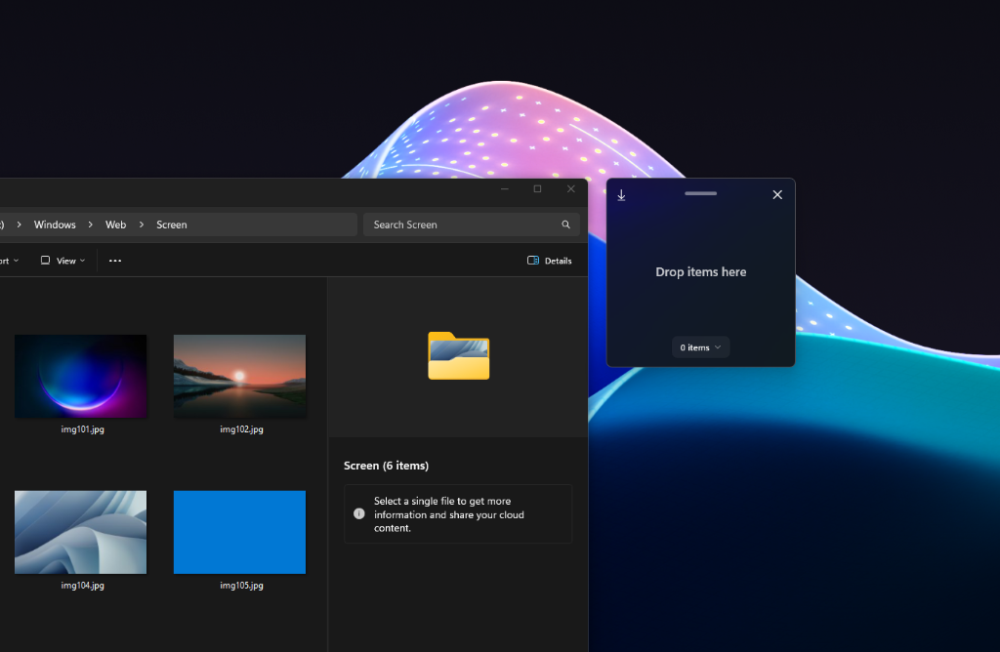
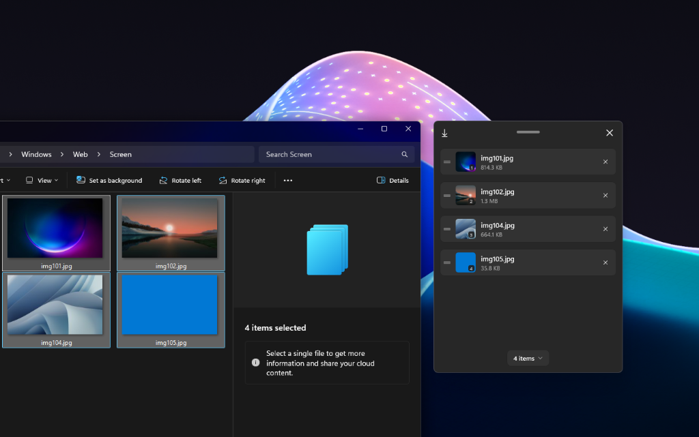
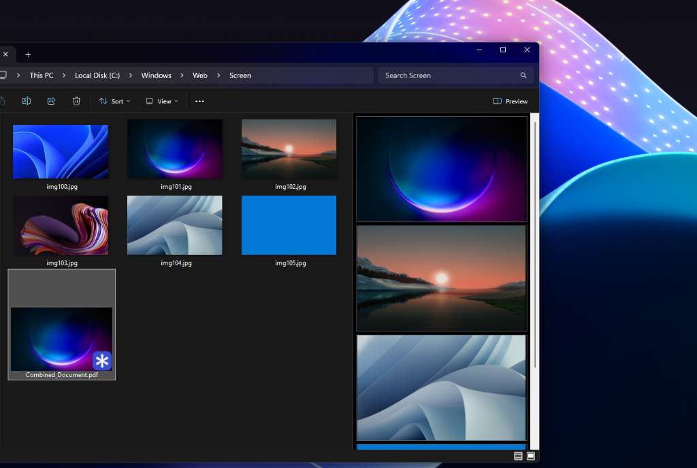

# PDFWin - Native Windows 11 Utility (WinUI 3)

**PDFWin** is a fast, ultra-lightweight Windows 11 utility built with **WinUI 3** and **.NET 8**. It lets you convert and merge images (JPG, PNG, WebP, TIFF, BMP) and PDF documents into a single optimized PDF with zero quality loss.

It integrates directly into the **Windows 11 primary context menu** as **"Create PDF"** (no *"Show more options"* needed) and offers an optional **always-on-top floating card** accessible via **`Win + Alt + P`**.

---

## Screenshots

### 1. Ready & Waiting (Drop items here)
A clean, unobtrusive floating card that stays on top while you collect files.

 

### 2. Smart Drag & Drop Queue
Instant reordering, natural numerical sorting (`img_1`, `img_2`, `img_10`), and quick actions.

 

### 3. High-Fidelity Combined PDF
Converts or merges files silently in the background, outputting directly to your destination folder.

---

## Highlights

- ⚡ **Native Windows 11 Context Menu**: Right-click any image, PDF, selection, or folder to find **"Create PDF"** on the main menu.
- 🪟 **Floating Fluent Card**: Toggle instantly with **`Win + Alt + P`** or via the system tray icon next to the clock.
- 🎯 **Lossless Engine**: JPEG stream pass-through (zero generation loss), lossless Flate PNG, and WIC hardware-accelerated decoding.
- 🪶 **Ultra-Lightweight & Compact**: Standalone installer under **27 MB**, only **~37 MB** on disk (via transparent LZX compression), and 0% CPU at idle.
- 🚀 **Official Startup App**: Clean registration in Windows 11 `Settings > Apps > Startup` (launches minimized to tray with `--startup`).

---

## Installation

1. Download **`PDFWin-Setup.exe`** from **[Releases](https://github.com/manuelcontrera/PDFWin/releases)**.
2. Run the installer (installs to `%LOCALAPPDATA%\Programs\PDFWin` without requiring Administrator privileges).
3. To uninstall, use **Windows Settings > Installed Apps** or run `Uninstall.exe`.

---

## How to Use

- **Context Menu**: Right-click files/folders in File Explorer ➔ Select **Create PDF**. A toast notification will pop up when done.
- **Floating Window**: Press **`Win + Alt + P`** ➔ Drag and drop images/PDFs ➔ Reorder if desired ➔ Click **Create PDF**.

---

## CLI Options

| Option | Description |
| :--- | :--- |
| `--silent-create <files...>` | Silently merges the specified files and shows a completion toast. |
| `--folder <folder_path>` | Merges all supported images and PDFs inside the folder. |
| `--startup` / `--minimized` | Starts minimized in the system tray. |
| `--register-menu` / `--unregister-menu` | Registers or unregisters Explorer context menu entries. |

---

## License & Author

Developed by **[Manuel Contrera](https://github.com/manuelcontrera)** under the [MIT License](LICENSE).
